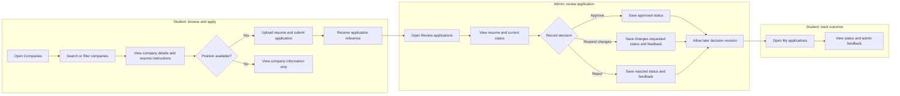
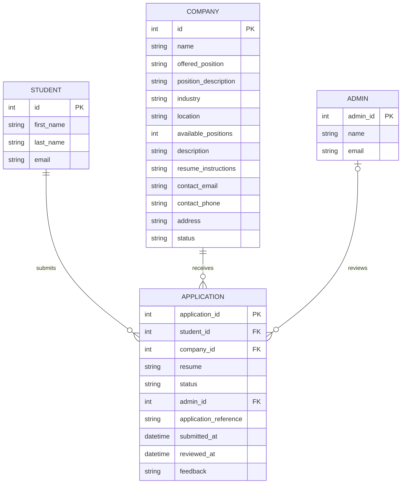
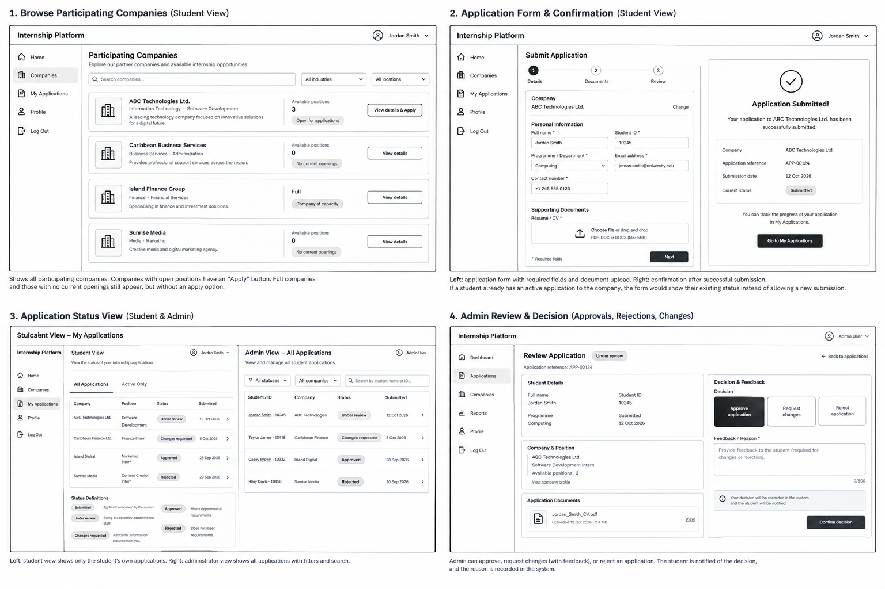

<!-- student-build:skill-integrity
status: pass
root: e84cd692d0b85eefe546385661958c27d07e8be6c5176a82012f68ccff5c8beb
expected_root: e84cd692d0b85eefe546385661958c27d07e8be6c5176a82012f68ccff5c8beb
mismatches: none
-->

# COMP 3613 Assignment 1

Draft this file with the Guide. **Update it after every phase milestone** before you pause. The use-case diagram is a UML PNG at `docs/diagrams/use-case.png`, linked from this file as `diagrams/use-case.png` (path relative to `docs/report.md`). The model diagram is Mermaid. **Embed wireframe images** as `wireframes/<file>` (files live in `docs/wireframes/`).

Do not put your student ID in this file if you will commit it. The PDF cover adds your name and ID at export time.

## Assigned project

Internship Platform

## Three workflows

The three assessed workflows remain:

### 1. Submit Student Application (Student)

The student views an available company, reads its position description and
resume instructions, uploads a PDF/DOC/DOCX resume, and submits the application.
The system creates a unique application reference and shows a confirmation.
Duplicate active applications to the same company are blocked; applications to
full companies are automatically rejected.

### 2. Browse Participating Companies (Student)

The student views all participating companies, searches by name, filters by
availability, and opens company details. Full companies remain visible for
information but do not expose an apply action.

### 3. Approve Application (Admin)

The administrator reviews submitted applications and resumes, then approves,
requests changes, or rejects with feedback. The same application can be
reviewed again so an administrator can revise its decision and feedback.

### Shared application status and feedback

Students use **My applications** to see every application reference, current
status, submission date, and administrator feedback. Administrators see the
current status and saved feedback in the review queue.

### Final workflow diagram

## Use case diagram

Final use-case decisions:

- Browsing participating companies and submitting an application remain separate use cases.
- Rejecting an application or requesting changes extends the administrator's application decision.
- Students and administrators share the application-status view.
- Companies with no available internship position remain visible as informational entries.
- Viewing company details includes the position description and resume-submission
  instructions.
- Submitting an application includes uploading a resume.
- Viewing decision feedback extends the shared application-status workflow for
  students.

## Model diagram

Final model and business rules:

- A student can submit applications to multiple companies.
- A student cannot have more than one active application to the same company.
- A rejected application allows the student to apply to that company again.
- Applications for companies whose positions are full are automatically rejected.
- One admin can review many applications. An application has an optional
  reviewing admin until a decision is recorded.
- Company descriptions and resume instructions support the detail/apply screen.
- Applications store a unique reference, submission/review timestamps, uploaded
  resume path, status, and one `feedback` field for administrator feedback or
  decision reasons.

## Wireframes

The student-created storyboard covers all three named workflows and the shared
application-status view:

### Browse Participating Companies (Student)

### Submit Student Application (Student)

### Approve Application (Admin)

The browse view keeps companies with no openings visible for information, while
only companies with available positions expose an apply action. The application
flow ends with a confirmation card and a status link. The admin review flow
supports approval, requesting changes with feedback, and rejection with a
recorded reason.

Phase 5 implemented the suggested application metadata as
`application_reference`, `submitted_at`, `reviewed_at`, and a single
administrator `feedback` field. `feedback` is used for request-change
instructions and approval/rejection reasons; there is no duplicate
`decision_reason` field.

`python manage.py report` also embeds any PNG/JPG still missing from `docs/wireframes/`.

### Internship Platform UI Wireframe Storyboard

## Theming

The application is branded **MyIntern** with a clean white-and-blue visual
system, black text highlights, rounded cards, and a sans-serif interface.
The theme is applied to the landing, login, registration, authenticated shell,
and company-browse screen.

## Implementation notes

### Browse Participating Companies (Student)

Implemented the Company SQLModel, repository filtering by company name and
availability, industry, and location, service delegation, authenticated
`/companies` route, navigation link, and storyboard-aligned company cards. Full
companies remain visible but do not expose an apply action. Available-position
counts are shown on company cards.

Verification: Pylance reports no errors in the new model, repository, service,
or route files. Student verification of the running UI is still required
before polish. The availability filter was then hardened to normalize values
and reject invalid states explicitly, including the common `avaliable` typo.
The authenticated-shell menu toggle now uses the sidebar's blue with a bold
white menu glyph for high contrast.

### Submit Student Application (Student)

Implemented the Application model and supporting Student/Admin domain tables,
resume upload handling, duplicate-active-application protection, automatic
rejection when a company is full, application references, submission
timestamps, and a confirmation screen. The browse workflow's available
company action now opens the upload form.

Verification: Pylance reports no errors in the application model, repository,
service, or route files. Student verification of the upload and confirmation
path is required before the admin workflow is built. A blank Companies page
was traced to an incorrectly placed template return after the application-form
route; the companies route now returns its template in its own handler.
Demo seeding now adds two available companies and one full company so the
workflow can be exercised after `python manage.py init`.
The detail/application view now persists and displays the student's latest
uploaded resume, company description, position, and resume submission
instructions when revisited.
If a student submits again while an active application already exists, the
existing application is automatically rejected, the reason is saved as
feedback, and the student returns to the same page with a warning notification
instead of seeing an error screen.

### Approve Application (Admin)

Implemented an admin-only review queue with approve, request-changes, and
reject decisions. The reviewer identity, feedback/reason, decision status, and
review timestamp are persisted. `feedback` is the single field used for both
request-changes instructions and rejection/approval notes; no duplicate
decision-reason field is used. Admins can revisit any reviewed application and
change its decision or update feedback. The review card now displays the
current decision, pre-fills saved feedback, and stacks decision controls to
avoid overflow on narrow cards. Status badges now change color consistently:
green for approved, yellow for changes requested, red for rejected, and grey
for pending review.

The shared status workflow is implemented at `/my-applications`. Students can
see each application status and read the administrator's saved feedback after
a decision. Final walkthrough verification passed for the student browse and
filter flow, company detail and resume instructions, resume upload and
persistence, admin approve/request-changes/reject decisions, decision
revision, status-color updates, and student feedback visibility.

### Dashboard polish

The student home now provides a MyIntern dashboard with open-company,
application, in-progress, and approved counts, recent applications, and a
direct action to explore companies. The admin home now provides application
totals, needs-attention/approved/rejected counts, recent submissions, open
company positions, and a direct review-queue action. Navigation now routes
each role to its own dashboard and hides student-only tracking links from
administrators.

### Final Phase 6 polish

Company discovery now matches the storyboard more closely with industry and
location filters, available-position counts, and richer company cards. Existing
Render databases are upgraded non-destructively at startup with the new
company columns. Company detail pages now include the company description,
position description, address, email, and phone. Admins can browse these
details but are redirected away from student-only application screens.
Both roles have a profile page showing account identity, username, email,
role, and account ID. Admin review cards now show the student's name, company,
and position rather than only database IDs.

Registration now collects first and last names in addition to username, email,
and password. These names are persisted with the account and displayed on the
profile page and student application records. Existing accounts receive safe
blank-name defaults through a non-destructive startup migration.

One named workflow at a time. Include verify notes and polish / model revisions
(Phase 5). Do not treat the first build as final.

## Deployed app

Phase 6. Public Render URL (not localhost). Markers open this to mark the three workflows.

https://faststarter-ekp8.onrender.com/

## Logins

Every account a marker needs, including extra users you added. Starter accounts:

- bob / bobpass — regular user
- admin / adminpass — admin

## YouTube URL

https://youtu.be/WOEmvxcZakQ

## Session transcripts

Filled when the Guide builds the report: the agent writes chat markdown into `docs/transcripts/`; `python manage.py report` packages them.

Guide packaged **2** chat(s) in `docs/transcripts/` (and `docs/transcripts.zip`).

Index: [docs/transcripts/INDEX.md](transcripts/INDEX.md)

- [`admin-profile-polish`](transcripts/admin-profile-polish.md)
- [`main-build-session`](transcripts/main-build-session.md)

## Competency (student-judge)

Filled by Guide from the student-judge run when this report was built.

# COMP 3613 Student-Judge Scorecard

## Summary

- **Awarded total:** 46 / 48
- **Scoreable max:** 48
- **Overall (average of scored metrics):** 3.8 / 4
- **Impression mark:** 19 / 20
- **Skips:** 0/3 used

## Scorecard

| ID | Metric | Score / 4 | In average | Evidence |
|---|---|---:|:---:|---|
| M1 | Phase discipline | 4 | yes | The student progressed through the required design phases, then implementation/polish, deployment, and post-deployment refinement. |
| M2 | Problem framing | 4 | yes | The student selected the internship platform, named three workflows, made include/extend and shared-status decisions, defined entities and business rules, and chose the visual direction. |
| M3 | Decision ownership | 4 | yes | The student decided workflow boundaries, rejection behavior, company visibility, entity relationships, branding, dashboard scope, and later polish requirements. |
| M4 | Artefact-before-code | 4 | yes | Wireframes, use cases, and the ERD were established and repeatedly updated before and during implementation. |
| M5 | Verification habit | 4 | yes | The student reported observed mismatches and continued refinement after deployment, including dashboard placeholders, company filters, admin details, duplicate submissions, role restrictions, profiles, and navigation labels. |
| M6 | Assignment fit | 4 | yes | The final product uses the wireframe-aligned workflows, layered routes/services/repositories/models, authenticated navigation, deployment, and non-destructive migrations. |
| M7 | Slice explanation | 3 | yes | The student clearly explained workflow behavior and observed UI mismatches. No additional code-check snippet evidence was elicited in the available chats. |
| M8 | Prompt quality | 4 | yes | Prompts were phase-directed and later became concrete, observable polish requests. |
| M9 | Response to pushback | 4 | yes | The student repeatedly rejected incomplete or mismatched behavior and requested targeted corrections rather than accepting the first build. |
| M10 | Integrity | 4 | yes | No evidence of skills being edited, answer-seeking, or transcript gaming. |
| M11 | Provenance continuity | 4 | yes | Implementation and polish remained grounded in the selected workflows, ERD, wireframe, deployment, and reported observations. |
| M12 | Sincerity trajectory | 3 | yes | The student maintained a consistent trajectory through design, implementation, deployment, and multiple rounds of concrete polish. |

## Strengths

- Strong ownership of the three assessed workflows and their edge cases.
- Clear wireframe-to-implementation refinement after deployment.
- Multiple user-observed mismatches led to focused fixes.
- The report, diagrams, deployment URL, marker logins, and demonstration video were updated.
- The implementation preserved the layered architecture and added migrations for deployed data.

## Gaps

1. The available transcript evidence does not include explicit Phase 5 code-check blocks; this is reflected in the modest M7 reduction.
2. The session history available to this export is condensed for the earlier phase chats rather than a complete raw-turn dump.

## Phase gate status

| Phase | Status | Note |
|---|---|---|
| 1 | met | Project and three workflows selected. |
| 2 | met | Use-case relationships, shared status, and edge cases decided. |
| 3 | met | Entities, properties, relationships, and business rules defined. |
| 4 | met | Student wireframe located and embedded; ERD retained and updated. |
| 5 | met | Theme, implementation, verification, and substantial polish completed. |
| 6 | met | Render deployment URL, marker logins, report fields, and video URL recorded. |

## Recommended next practice

For future work, record explicit architecture/code-check notes when introducing a
new workflow so implementation-confidence and layer decisions are easier to
audit later.

## Integrity note

Clean. The scorecard is based on the native project sessions available to the
Guide and the current repository state. No unavailable chats were invented.

## Skill integrity

Course skills are hashed at export and compared to `.agents/skills.lock.json`. Do not edit `.agents/skills/`, `.cursor/skills/`, or `AGENTS.md`.

- Status: **pass**
- Root: `e84cd692d0b85eefe546385661958c27d07e8be6c5176a82012f68ccff5c8beb`
- none
